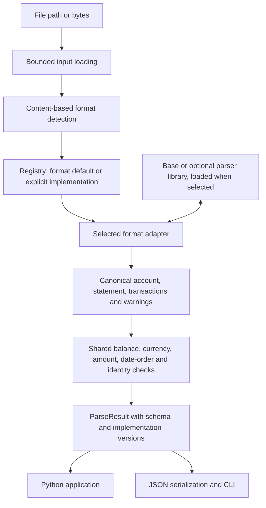

# BankParser

BankParser provides one local parsing and validation API for structured bank
files. It produces a common Python model for accounting imports and
reconciliation workflows, preserving exact `Decimal` amounts, separate dates
and references, source metadata, warnings and validation results.

The runtime combines native parsing with adapters for optional parser
implementations. BankParser owns the public API, content-based format detection,
implementation selection, canonical model, shared financial checks and JSON/CLI
output. Each implementation works behind that contract. MT940 and native CSV
are available in the lightweight base installation; add format or implementation
extras as needed. More optional implementations are planned.

## Architecture



Adapters can parse directly, use an external library, or combine source
extraction with backend consistency checks. Native CSV parses source rows using
Python's standard library. The default OFX adapter uses our XML/SGML source
reader and checks its financial fields against the selected library's output.
Other adapters normalize their backend output and retain available source
details. All feed the same canonical model and shared validation layer.

The canonical contract is independent of a backend's DataFrames or internal
objects. Changing implementations preserves the result structure; extracted
values, supported input profiles and warnings can differ. The result identifies
the format, implementation and versions so callers can inspect that choice.

The [adapter contract](src/bankparser/parsers/base.py) and
[registry](src/bankparser/parsers/registry.py) provide the internal structure for
adding implementations. New adapters need source/profile checks, canonical
mappings and independently checked fixtures, with external dependencies declared
as optional extras. Runtime plugin discovery and a supported public registration
API are future work; current implementations are registered in the library.

## Install

Python 3.10 or newer. Version 0.5.0a1 is the first alpha pre-release. Install from a checkout until release assets are published:

```bash
python -m venv .venv
source .venv/bin/activate
python -m pip install -e .
```

| Installation | Purpose | Install from this checkout |
| --- | --- | --- |
| Base | MT940 and native CSV | `python -m pip install -e .` |
| OFX | Base plus the default OFX/QFX implementation | `python -m pip install -e ".[ofx]"` |
| CAMT | Base plus the current CAMT.053 implementation | `python -m pip install -e ".[camt]"` |
| Alternative | Base plus the current additional backend for explicit selection | `python -m pip install -e ".[alternative]"` |
| All | All currently offered implementations | `python -m pip install -e ".[all]"` |

The base package has one external dependency, `mt-940`; native CSV uses the
standard library. It does not install pandas, NumPy or XML libraries. The OFX
extra adds XML/HTML parsing dependencies, including lxml, but avoids pandas and
NumPy. Current CAMT and alternative implementations bring the heavier DataFrame
dependency stack. Choose extras for the formats/backends you need; installing
`all` installs their combined dependencies even though imports remain lazy.

The `csv` extra is a compatibility alias that adds no dependencies. Development
tools are a separate `dev` extra. See the [dependency guide](docs/dependencies.md)
for exact backend versions, XML security requirements and dependency profiles.

Alpha release assets, when available, will be listed on the project's
[GitHub Releases page](https://github.com/ankurmalik04/-bank-txn-reader/releases).
Missing-backend errors provide commands for a downloaded wheel and a source
checkout.

## Quick start

No optional dependencies or sample files are needed for this CSV example:

```python
from decimal import Decimal
from bankparser import parse

statement = (
    b"Booking Date,Value Date,Amount,Currency,Description,Reference\n"
    b"2026-10-01,2026-10-02,-12.50,GBP,Invoice payment,INV-001\n"
)
result = parse(statement)

assert result.source.implementation == "native"
transaction = result.transactions[0]
assert transaction.amount == Decimal("-12.50")
assert transaction.reference == "INV-001"
print(transaction.booking_date, transaction.value_date)

for check in result.validation.checks:
    print(check.code, check.status)
```

Generic CSV supplies transactions without reliable opening/closing balances, so
this example returns validation status `warning`: balance reconciliation is
skipped. The parsed movements remain available, and currency and finite-amount
checks still run.

Paths use the same interface, with content-based format detection:

```python
result = parse("corpus/mt940/basic_valid.mt940")
assert result.account.currency == "GBP"
assert result.validation.status == "passed"
print(result.transactions[0].reference)  # MATERIAL
```

Incoming amounts are positive; outgoing amounts are negative. Missing fields
remain `None`. QFX belongs to the `ofx` format family. See the
[API guide](docs/api.md) for result fields, parser selection and errors.

## Choose an implementation

Formats and implementations are separate choices. Content detection identifies
the format; the registry then selects its default unless `implementation` is
provided. Installation extras make backends available and do not change defaults.

| Format | Default implementation | Optional alternative | Required extra for the default |
| --- | --- | --- | --- |
| CSV | `native` | `bankstatementparser` | None |
| MT940 | `wolph` (the `mt-940` package) | `bankstatementparser` | None |
| OFX/QFX | `ofxparse` | `bankstatementparser` | `ofx` or `all` |
| CAMT.053 | `bankstatementparser` | None currently | `camt` or `all` |

`bankstatementparser` is one optional backend offered through format adapters.
It currently supplies CAMT parsing and additional CSV, MT940 and OFX
implementations. Native parsing and other library adapters share the same
BankParser API; additional implementations can be added through the adapter
contract as their profiles and evidence are established.

After installing the `ofx` extra, an explicit choice looks like:

```python
result = parse(
    "corpus/ofx/basic_valid.ofx",
    implementation="ofxparse",
)
assert result.source.implementation == "ofxparse"
```

There is no automatic fallback or dependency installation. A selected backend
whose dependencies are missing raises `MISSING_DEPENDENCY`. In particular,
`alternative` alone does not install the default OFX implementation; select its
OFX alternative explicitly or also install `ofx`. `implementations(format)` lists
registered names, including optional backends that are not installed.

The `alternative` or `all` extra enables the nondefault implementations in the
table above; pass their implementation ID to select one explicitly.

Source guards and supported profiles belong to each adapter. For example, the
default OFX implementation preserves source-local booking dates, checks counts
and financial fields, and rejects unsupported financial activity. Alternatives
can have different boundaries; consult [compatibility](docs/compatibility.md)
before switching.

## CSV conventions

CSV retains Booking Date, Value Date, Transaction ID and Reference separately.
Original cells, including unrecognised columns, remain in
`transaction.raw["source_fields"]`; `source_line` identifies the physical line
where the record ends.

An amount such as `"1,234"` is ambiguous. Supply explicit conventions:

```python
from bankparser import CsvOptions, parse

result = parse(
    "corpus/csv/ambiguous_amount.csv",
    csv_options=CsvOptions(decimal_separator=".", grouping_separator=","),
)
assert result.transactions[0].amount == 1234
```

Set `date_format="%d/%m/%Y"` for ambiguous day/month dates. A generic Date stays
in raw metadata rather than becoming a booking/value date. Running balances stay
in raw metadata rather than establishing statement balances. Both cases produce
explicit warnings. Debit/Credit cells must contain non-negative magnitudes;
use an Amount column for signed values.

Native CSV consumes rows incrementally without DataFrames or temporary files.
The public API still reads a bounded input and returns the complete transaction
collection. Header-only files raise `EMPTY_STATEMENT`. The optional CSV
compatibility adapter shares native field mapping and adds a backend count check;
agreement between these implementations does not independently verify fields.

## Validation and errors

```python
from bankparser import BankParserError, parse

try:
    result = parse("corpus/mt940/basic_valid.mt940")
except BankParserError as exc:
    print(exc.code, exc.location, str(exc))
else:
    print(result.validation.status)
    for warning in result.warnings:
        print(warning.code, warning.location)
```

Validation runs five checks: `BALANCE_RECONCILIATION`, `CURRENCY_CONSISTENCY`,
`FINITE_AMOUNTS`, `STATEMENT_DATE_ORDER` and `ACCOUNT_IDENTITY`.
Reversed statement bounds fail; missing bounds skip the date-order check.
Missing account ID and IBAN skip the identity check and add
`MISSING_ACCOUNT_IDENTITY`; generic CSV remains parseable. A present identifier
is not independently verified. Aggregate status is `passed` when all checks pass,
`warning` when a prerequisite is missing, and `failed` when a check finds a
contradiction. Parse warnings are separate from the validation status; inspect
both. Parsing and balance validation isolate their Decimal arithmetic from the
embedding application's settings.

Passing checks do not prove document authenticity, complete extraction, or
agreement with an accounting ledger. BankParser currently accepts one
statement/account scope per input, up to 5 MiB. Bank connections, PDF/image
extraction and matching against ledger entries are outside this library's scope.
The [compatibility guide](docs/compatibility.md) describes tested conventions,
fixtures and remaining format limits.

## JSON and CLI

```python
import json
from bankparser.serialization import to_primitive

print(json.dumps(to_primitive(result), indent=2))
```

JSON amounts are strings and dates are ISO strings. The current schema is `1.1`;
see the [migration notes](CHANGELOG.md) for added fields and changed behaviour.

```bash
bankparser --version
bankparser corpus/mt940/basic_valid.mt940 --strict-validation
bankparser parse corpus/csv/ambiguous_amount.csv --decimal-separator . --grouping-separator ,
bankparser parse corpus/csv/negative_debit.csv --json-errors
bankparser implementations csv
```

Results go to stdout; errors go to stderr. Parse command exit codes are:

| Exit | Meaning |
| --- | --- |
| 0 | Parsed without failed validation; skipped checks are allowed by default. |
| 2 | Loading, detection, dependency, option or parsing error. |
| 3 | Validation failed, or was incomplete with `--strict-validation`. |

`--json-errors` emits a parse error object with `code`, `message` and nullable
`location`. Generic CSV usually exits `3` under `--strict-validation` because
statement balances or account identity are unavailable. `bankparser FILE` remains supported.

## Compare implementations

Comparison uses the same adapter registry. Install the implementations you want
to compare; the current MT940 pair can be exercised with:

```bash
python -m pip install -e ".[alternative]"
bankparser compare corpus/mt940/basic_valid.mt940
bankparser compare corpus/csv/ambiguous_amount.csv --decimal-separator . --grouping-separator ,
```

Or call `compare(path)` from Python. Every implementation receives the same input
snapshot. The report excludes source provenance and raw metadata, and compares
the remaining fields, checks and warnings. Monetary values compare numerically:
`"10.0"` and `"10.00"` agree, without rounding. Actual differences retain their
original serialized values. Other fields compare exactly. Both Python
`compare(path, csv_options=CsvOptions(...))` and the CLI accept the same CSV
options as parsing, including `--date-format`. Agreement establishes
consistency on that input, not correctness.

Comparison requires at least two configured implementations and their installed
dependencies; explicit selection runs only the selected implementations, and
parser errors abort comparison. The CLI exits `0` for a completed
comparison, including one with differences. Inspect the JSON `matches` field in
automation. `implementations(format)` lists configured names, even when an
optional dependency is absent.

## Development

```bash
python -m pip install -e ".[dev,all]"
python corpus/generate.py --check
ruff check src tests corpus/generate.py scripts
mypy src/bankparser
python -m pytest --cov=bankparser --cov-branch --cov-report=term-missing
python -m build
```

Examples are in [examples/](examples/). The [contribution guide](CONTRIBUTING.md)
and [provenance record](corpus/PROVENANCE.md) explain independently authored
fixtures and expectations. BankParser is available under the [MIT license](LICENSE).

See the [support policy](SUPPORT.md) for alpha maintenance and schema
compatibility, [security policy](SECURITY.md) for vulnerability reporting, and
[dependency audit](docs/dependency-audit.md) for dated license/advisory evidence.
